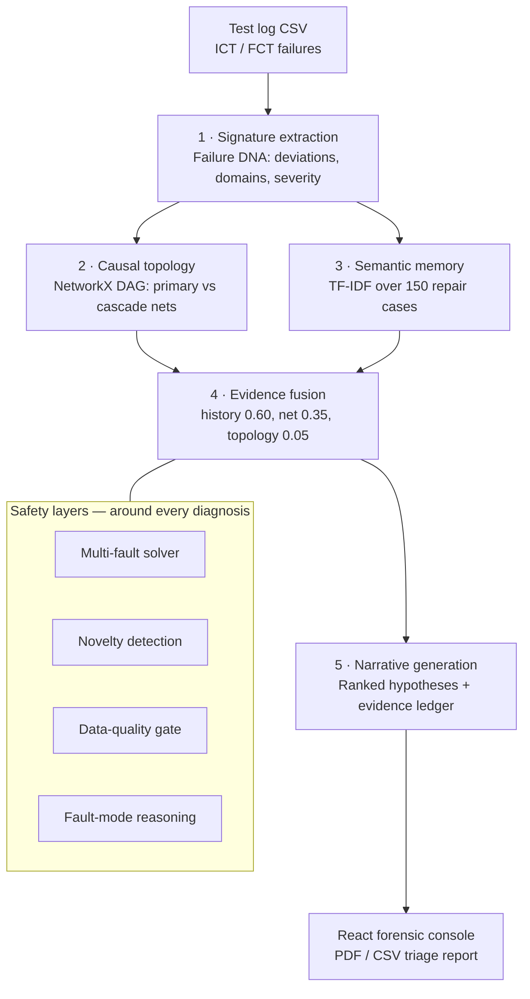
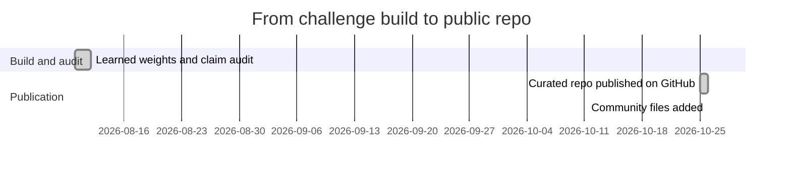
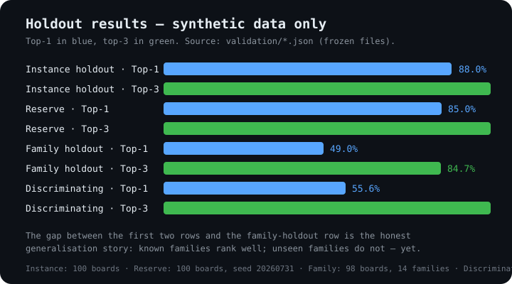

<div align="center">


# CircuitMind

[](https://github.com/Aneeshparveda/CircuitMind)

*Deterministic PCB fault diagnosis — no LLM, no API keys, no internet. Same log in, same ranking out, every time.*

[](requirements.txt)
[](LICENSE)
[](tests/)
[](#why-this-exists)
[](#why-this-exists)
[](#why-this-exists)
[](https://github.com/Aneeshparveda/CircuitMind/commits/main)
[](https://github.com/Aneeshparveda/CircuitMind/stargazers)

</div>

> **⚠️ Read this first — the honest status box, kept on purpose**
>
> CircuitMind is a **deterministic, offline PCB fault-diagnosis prototype** built for the **AI Domain X Challenge 2026 (team Dragons, problem PS01)**. It is **not** a production factory tool. Every benchmark number below comes from the project's own **synthetic data** (see [data/DATA_CARD.md](data/DATA_CARD.md)), so it proves internal consistency and reproducible ranking — **not** real-world factory accuracy. Diagnoses are labelled as probable matches that require physical verification, never as confirmed faults.

## Contents

- [Why this exists](#why-this-exists)
- [A worked example: the U3 cascade](#a-worked-example-the-u3-cascade)
- [What it does](#what-it-does)
- [Architecture](#architecture)
- [Results — synthetic data only](#results--synthetic-data-only)
- [Quick start](#quick-start)
- [Project structure](#project-structure)
- [Data](#data)
- [Tests and benchmarks](#tests-and-benchmarks)
- [Limitations](#limitations)
- [Roadmap](#roadmap)
- [Contributing](#contributing)
- [License](#license)
- [Acknowledgements](#acknowledgements)

---

## Why this exists

A factory PCB fails its in-circuit or functional test. Today, finding out *why* means an engineer reading the failure log, the board design, the BOM and old repair records by hand. That process is **manual, slow, inconsistent between engineers, and expertise-dependent** — when the experienced engineer leaves, the knowledge leaves with them.

CircuitMind replaces that reading with **structured evidence reasoning**: it takes the test log, the BOM, the board's electrical topology and 150 past repair cases, and returns a ranked list of probable root causes — each one explained by named evidence, with a confidence tier and a downloadable triage report. No model you cannot inspect, no answer you cannot audit.

## A worked example: the U3 cascade

The repo's hero demo board is `BRD_U3_CASCADE_001` (see [JUDGE_ONEPAGER.md](JUDGE_ONEPAGER.md) and `data/u3_cascade_demo_log.csv`):

| What the tests showed | What it meant |
|---|---|
| 5 V rail at 3.7 V, 3.3 V rail at 2.68 V, dead MCU, dead SPI flash | 4 failed tests, 1 primary rail, 2 cascade nets |
| **Leading hypothesis: U3 — TPS54331 buck regulator** | Score **74.0 / 100**, explaining 4 / 4 failures by mechanism |
| The honest caveat, disclosed in the one-pager itself | The closest historical match pointed to F1, not U3 — a supporting precedent for U3 exists but ranks below it, so retrieval leans against the leader |

That last row is the point. The system does not hide the evidence that disagrees with its own answer — it shows it, and ranks by evidence anyway. Connectivity says who *could* have done it; the evidence streams say who did.

## What it does

| Capability | How it works | Where it lives |
|---|---|---|
| 🔍 **Failure fingerprinting** | Deviations, domains, severity and error codes extracted from the raw log into a "failure DNA" | [engine/signature_extractor.py](engine/signature_extractor.py) |
| 🕸️ **Causal topology** | NetworkX DAG separates primary nets from cascade nets, so a dead downstream block is not blamed for an upstream rail failure | [engine/topology_dag.py](engine/topology_dag.py) |
| 🧠 **Repair memory** | TF-IDF + cosine retrieval over 150 past repair cases (10 per fault family) | [engine/semantic_memory.py](engine/semantic_memory.py) |
| ⚖️ **Evidence fusion** | Learned weights — history **0.60** · net **0.35** · topology **0.05** (criticality and category **0.00**) | [engine/evidence_fusion.py](engine/evidence_fusion.py), [config/diagnostic_weights.json](config/diagnostic_weights.json) |
| 📝 **Narrative + receipt** | Human-readable forensic summary plus an evidence ledger and a versioned diagnostic receipt | [engine/narrative_generator.py](engine/narrative_generator.py), [engine/diagnostic_receipt.py](engine/diagnostic_receipt.py) |
| 🧩 **Multi-fault solving** | Sparse set-cover over mechanism coverage, with a parsimony penalty — names both faults on the dual-fault benchmark | [engine/multi_fault_solver.py](engine/multi_fault_solver.py) |
| 🚨 **Novelty detection** | Out-of-distribution boards are flagged and demoted to Inconclusive, never presented as a confident Strong match | [engine/ood.py](engine/ood.py) |
| 🛡️ **Data-quality gate** | GREEN / AMBER / RED input grading; RED input leads to ABSTAIN with an explicit "what's needed next" block | [engine/data_quality.py](engine/data_quality.py) |
| 🌱 **Verified learning only** | Only confirmed repairs (retest PASS + technician confirmation) enter learnable memory, kept separate from the frozen benchmark corpus | [engine/repair_memory.py](engine/repair_memory.py), [data/learned_cases/](data/learned_cases/) |
| 🎯 **Next Best Test** | Recommends the most informative next check, weighted by information gain, risk and effort | [engine/evidence_fusion.py](engine/evidence_fusion.py) |
| 🖥️ **Forensic console** | React console (Vite + TypeScript) served by Streamlit: upload a log, run a fleet scan, export PDF / CSV triage reports | [frontend-vite/](frontend-vite/), [app.py](app.py), [reports/](reports/) |

## Architecture





## Results — synthetic data only

All numbers below are from the **frozen files in [validation/](validation/)** — they are not re-measured here, and they describe synthetic-vs-synthetic performance only. Read them with their dataset names attached; a bare "88% accurate" would be misleading.



| Benchmark (dataset) | Top-1 | Top-3 | Notes |
|---|---:|---:|---|
| **Instance holdout** — known fault families, 100 blind boards ([validation/metrics.json](validation/metrics.json)) | **88.0%** | **100.0%** | Top-5 100%, MRR 0.92, nDCG@3 0.94, domain 96%, median inference ~5.1 ms |
| **Reserve test** — boards never seen by any split, 100 boards, seed 20260731 ([validation/reserve_metrics.json](validation/reserve_metrics.json)) | **85.0%** | **100.0%** | Domain 99%, MRR 0.90, median inference ~5.0 ms |
| **Fault-family holdout** — unseen families, 98 boards, 14 families ([validation/benchmark_report.json](validation/benchmark_report.json)) | **49.0%** (weighted) | **84.7%** (weighted) | The honest generalisation gap — disclosed deliberately, not hidden. Unweighted: 42.9% / 85.7% |
| **Discriminating** — same failed tests, different root causes, 27 boards ([validation/discriminating_metrics.json](validation/discriminating_metrics.json)) | **55.6%** | **100.0%** | Exact-pattern matching falls to 22.2% here; the engine keeps the truth in the top 3 |
| **Baselines**, same frozen blind split ([validation/baseline_report.json](validation/baseline_report.json)) | — | — | Majority 6%, exact-pattern 88%, Jaccard 88%, TF-IDF-only 62%, current fusion 88% top-1 — the headline alone proves nothing |

Also verified in the audit notes ([CLAIMS.md](CLAIMS.md)):

- **Zero silent misses** on the blind set: all 12 top-1 misses still ranked the truth in the top 3; 0 outside the top 3.
- **Multi-fault:** the solver names both true components (U3 + R12) on the dual-fault benchmark boards.
- **Adversarial / OOD:** novel boards are flagged 100% of the time and never confidently misdiagnosed; noisy boards 90% top-1, missing-BOM boards 90% top-1.
- **Ablation:** full fusion 88% / 100%; history-only 62% / 67%; net-only 60% / 85%; topology-only 43% / 85% — the fusion is doing real work, not riding one stream.
- **Learned vs hand-set policy:** 78% → 88% top-1 (91% → 100% top-3) from learning the weights on 300 labelled boards.

Confidence tiers are **score buckets with measured benchmark frequencies per tier — not statistical probabilities**. Never quote a tier as "X% chance".

### Demo

<!-- TODO: add result — no screenshot, GIF, video, or live demo exists in the repo yet. Add a console screenshot to assets/ and link it here. -->

Until then, the fastest demo is the built-in one: run the app and pick the **U3 cascade**, **dual-fault**, or **novel board** demo logs (see [Quick start](#quick-start)).

## Quick start

Prerequisites: Python 3.9+, Node.js 18+ (for the frontend build), 4 GB RAM minimum.

```bash
git clone https://github.com/Aneeshparveda/CircuitMind.git
cd CircuitMind
pip install -r requirements.txt
cd frontend-vite && npm install && npm run build && cd ..
streamlit run app.py --server.port 8510 --server.headless true
```

Open http://localhost:8510.

> The frontend **must** be built first: `app.py` stops with an error if `frontend-vite/dist/` does not exist. The `dist/` build output is intentionally not committed — rebuild it with `npm run build`.

Docker (builds the frontend inside the image):

```bash
docker build -t circuitmind .
docker run -p 8510:8510 circuitmind
```

<details>
<summary><b>Full setup, usage, and troubleshooting</b></summary>

### Diagnose a board

- Upload a test-log CSV in the app (up to 5 MB), or pick a built-in demo board (U3 cascade, dual-fault, novel board).
- Input log format: CSV rows of `board_id, test_step, measured_value, expected_min, expected_max, unit, pass_fail, error_code` (see [data/test_logs.csv](data/test_logs.csv) and [data/DATA_CARD.md](data/DATA_CARD.md)). Error codes in the corpus: `VAL`, `FNC`, `OPN`, `SHT`.

### Useful commands

```bash
python3 data/generate_synthetic.py          # regenerate the synthetic corpus (seed 42)
python3 -m pytest tests/ -v                 # run the test suite
python3 validation/validate_accuracy.py     # run one benchmark (from the project root only)
python3 validation/run_all_benchmarks.py    # full suite: writes validation/benchmark_report.json
                                             # and docs/VALIDATION_REPORT.md
python3 validation/learn_weights.py         # re-derive the learned weights
```

### Troubleshooting

- **App stops complaining about `frontend-vite/dist/`** — you skipped the frontend build. Run `cd frontend-vite && npm install && npm run build && cd ..` first.
- **`validation/validate_accuracy.py` fails oddly** — it only works when run from the project root; the other validators are path-relative. Run it from `CircuitMind/`.
- **PDF report looks wrong on Linux/Windows** — the helper scripts in `tools/` use macOS-only font paths. That is a known limitation, not your setup.
- **Three version fields show as `?` in a PDF footer** — known: the version keys the footer reads are not provided. Cosmetic only.

### Tech stack

| Layer | Stack |
|---|---|
| Engine | Python 3.9+, pandas, NumPy, scikit-learn (TF-IDF), NetworkX (DAG) |
| App host | Streamlit 1.35.0 |
| Console | React 19, TypeScript, Vite, Tailwind CSS, served as a Streamlit custom component |
| Reports | fpdf2 (PDF), CSV export |
| Tests | pytest |
| Containers | Docker multi-stage build (node:22-slim → python:3.11-slim) |

[](#)
[](#)
[](#)
[](#)
[](#)
[](#)

</details>

## Project structure

```text
app.py                  Streamlit host for the React forensic console
engine/                 Deterministic diagnosis pipeline (5 stages + safety layers)
  signature_extractor.py  Failure DNA from the raw log
  topology_dag.py         NetworkX DAG: primary vs cascade, functional, observability
  semantic_memory.py      TF-IDF retrieval over 150 repair cases
  evidence_fusion.py      Learned-weight fusion + Next Best Test
  narrative_generator.py  Ranked hypotheses + evidence ledger
  multi_fault_solver.py   Sparse set-cover multi-fault solver
  ood.py                  Novelty / out-of-distribution detection
  data_quality.py         GREEN / AMBER / RED gate + ABSTAIN
  fault_modes.py          Mechanism library (connectivity != causality)
  repair_memory.py        Verified-only learning protocol
  test_integrity.py       Tester-vs-board fleet analysis
data/                   Synthetic BOM, topology, test logs, repair history, data card
  learned_cases/        Verified learned repair cases (demo-scoped)
config/                 Learned fusion weights (diagnostic_weights.json)
validation/             Benchmarks, ground truth, and frozen metric JSONs
tests/                  pytest suite (103 test functions, 5 files)
reports/                PDF and CSV triage-report generators
tools/                  Scripts that render the one-pager / code PDFs
frontend-vite/          React forensic console (Vite + TypeScript)
  src/                  Console components (built with npm run build)
  public/               Static assets served with the build
docs/                   Architecture, model card, validation report, benchmarks,
                        claims audit, setup, demo cases, presentation
assets/                 README artwork (this page's results chart)
```

## Data

**All data in this repository is synthetic.** No organiser-provided dataset existed for this problem, and no proprietary or confidential factory data is used anywhere. Full inventory, generation method (seed 42), splits, and leakage controls are in [data/DATA_CARD.md](data/DATA_CARD.md).

| File | Contents |
|---|---|
| `data/components.csv` | 20-component BOM |
| `data/net_connections.csv` | Pin-level electrical connectivity |
| `data/functional_dependencies.csv` | Component dependency edges |
| `data/test_observability.csv` | Test step → what it observes |
| `data/test_net_map.csv` | Test step → net/domain/level |
| `data/test_logs.csv` | 500 synthetic boards × 11 test steps |
| `data/test_logs_reserve.csv` | 100 reserve boards (BRD_0500+) |
| `data/repair_history.csv` | 150 historical repair cases (10 per fault family) |
| `data/evidence_policy.json` | Hand-set fusion policy (fallback) |
| `config/diagnostic_weights.json` | Learned fusion weights (canonical) |
| `validation/ground_truth_*.csv` | Board → root cause + scenario + split |

Known residual, stated plainly in the data card: all 500 boards (including the 100 blind boards) live in `test_logs.csv`, which feeds per-pattern signal statistics; root-cause labels never enter those signals. The correct wording is "instance holdout, known families" — never "zero leakage".

## Tests and benchmarks

- Tests: `python3 -m pytest tests/ -v` — 103 test functions across `tests/test_engine.py`, `tests/test_refinements.py`, `tests/test_diagnostic_contract.py`, `tests/test_diagnostic_receipt.py`, and `tests/test_learning_protocol.py`, covering the engine, diagnostic contract and receipt, refinements, and the learning protocol (including the rule that the blind test set never influences weight selection).
- Benchmarks: `validation/run_all_benchmarks.py` produces sections A–H (C and D combined in one entry): instance holdout, family holdout, adversarial + OOD, ablation, reserve, baselines, and discriminating. Frozen results are committed under `validation/*.json` so numbers can be checked without rerunning anything.

## Limitations

- **Synthetic only.** One canonical board topology, 15 fault families, uniform-random measurements within fixed windows. No temperature, ageing, intermittent-fault, or board-revision dynamics are modelled.
- **Known-family performance does not transfer for free.** Unseen-family top-1 is 49.0% (weighted) — real accuracy on real repair history would need to be measured from scratch.
- **Confidence tiers are score buckets**, not posterior probabilities. Do not quote a tier as "X% chance".
- **Diagnoses require physical verification.** The engine recommends a probable root cause and next checks; it does not confirm a fault.
- **Multi-fault** handling is demonstrated on the benchmark's dual-fault family; general real-world multi-fault diagnosis remains an open problem.
- Runtime figures (~5 ms median on the validated demo environment) are environment-dependent.
- **Platform notes.** The PDF helper scripts in `tools/` use macOS-only font paths and will fail on Linux/Windows; the PDF report footer renders three version fields as `?` because the version keys it reads are not provided; and `validation/validate_accuracy.py` only works when run from the project root (the other validators are path-relative).

## Roadmap

Based on the repo's real status — done items are in the repo today, planned items are the open limitations, with no dates promised:

- [x] Five-stage deterministic pipeline with safety layers (data-quality gate, OOD flagging, verified-only learning)
- [x] Learned fusion weights, reproducible from 300 labelled boards (`validation/learn_weights.py`)
- [x] Full benchmark suite (A–H) with frozen, checkable results
- [x] React forensic console with PDF / CSV triage reports
- [x] Claim registry ([CLAIMS.md](CLAIMS.md)) — every public claim traceable to evidence
- [ ] Measure accuracy on real repair history from scratch (the synthetic numbers do not transfer for free)
- [ ] General multi-fault diagnosis beyond the dual-fault benchmark family
- [ ] Fix the `tools/` PDF helpers' macOS-only font paths and the `?` PDF footer fields
- [ ] Make `validation/validate_accuracy.py` path-relative like the other validators
- [ ] Add a console screenshot / demo GIF to this README (see TODO below)
<!-- TODO: add result — roadmap dates and any release plan are not in the repo; add them only when the team sets them. -->

## Contributing

See [CONTRIBUTING.md](CONTRIBUTING.md), [CODE_OF_CONDUCT.md](CODE_OF_CONDUCT.md) and [SECURITY.md](SECURITY.md). The short version, from those files:

- Keep the honesty intact: every benchmark number comes from synthetic data, and every new claim needs evidence in [CLAIMS.md](CLAIMS.md).
- Never commit real proprietary factory data, credentials, or personal information — use synthetic or redacted examples in issues.
- Keep dependencies pinned in `requirements.txt`, and say why if a version changes.
- The app processes uploaded test-log CSVs locally and sends them nowhere; keep it that way.

## License

MIT — see [LICENSE](LICENSE). This was a team hackathon project (team Dragons, AI Domain X Challenge 2026); the copyright line names Aneesh Parveda as the repository publisher and should be confirmed before any wider redistribution. (This caveat is carried over verbatim from the original README — it is unresolved, not hidden.)

## Acknowledgements

- **Team Dragons** — AI Domain X Challenge 2026, problem PS01 (PCB fault diagnosis).
- The challenge organisers, for a problem statement that asked for reasoning and confidence, not just a label.
- The open-source libraries that make the offline pipeline possible: pandas, NumPy, scikit-learn, NetworkX, Streamlit, React, Vite.

---

<div align="center">


**If this helped you triage a board, star the repo — it tells the next engineer this approach is worth a look.**

⭐ **[Star CircuitMind](https://github.com/Aneeshparveda/CircuitMind)**

</div>
